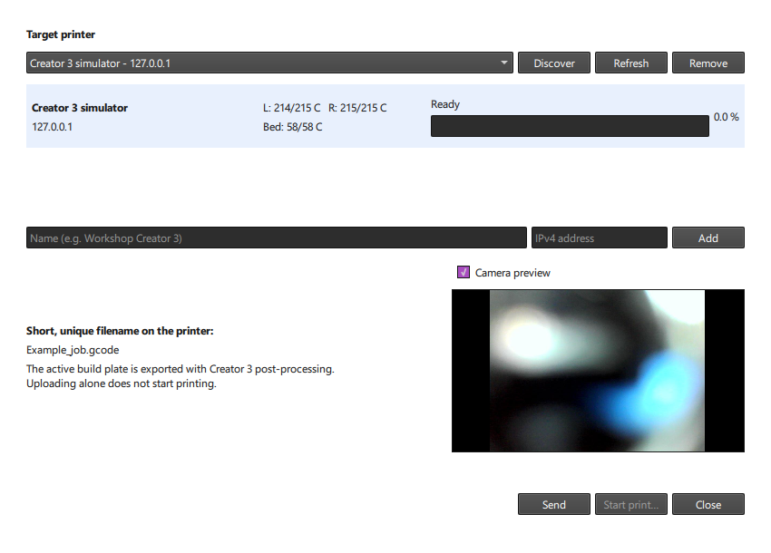
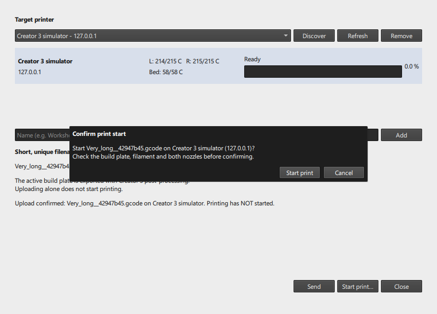

# Flashforge Creator 3 + Cura

**Keep Cura's toolpaths. Restore Creator 3 compatibility. Print with either nozzle, or use native IDEX mirror and duplicate modes.**

A community integration for the **original Flashforge Creator 3**, combining a two-extruder machine definition, a fail-closed native G-code post-processor, and a local-network **Send to printer** extension.

> **Read before printing:** this is not a generic Marlin profile and not an official Flashforge release. The machine definition and post-processing script must be used together. Start with a small, supervised single-extruder test. Do not print a blocked export or bypass calibration checks.

## Contents

- [Why this project exists](#why-this-project-exists)
- [What works, and what does not](#what-works-and-what-does-not)
- [Requirements](#requirements)
- [Installation and rollback](#installation-and-rollback)
- [First print and machine settings](#first-print-and-machine-settings)
- [Single-extruder printing](#single-extruder-printing)
- [IDEX mirror and duplicate](#idex-mirror-and-duplicate)
- [Alternating heads: experimental dual-material printing](#alternating-heads-experimental-dual-material-printing)
- [Raft and supports](#raft-and-supports)
- [Send to printer](#send-to-printer)
- [How the problem was solved](#how-the-problem-was-solved)
- [Validation and troubleshooting](#validation-and-troubleshooting)
- [Development, provenance and license](#development-provenance-and-license)

## Why this project exists

The Creator 3 can still be a capable printer, but its usefulness depends heavily on the software driving it. FlashPrint worked randomly with my machine and its slicing controls were limiting for my projects.

I got this printer for quite cheap and the hardware is rock solid and serviceable as needed. The biggest issue was the lack of software support but I was at least able to print with right extruder on Cura.

My personally tuned Cura profile gave me the best results I had achieved so far. However, it only drove the **right extruder**, and printed models roughly **80 mm to the right** of their position in Cura. Moving every object to the far left before slicing was my workaround, not a solution.

I tried profiles found in different places online, but none met my combination of requirements: keep my established Cura quality, fix positioning, use the left nozzle, and make both IDEX modes work reliably. Changing the selected G-code flavor affected positioning and appeared to affect quality, but that observation alone was not proof of a causal quality difference.

I therefore **started from my working personal profile**, rather than replacing it with another downloaded Creator 3 profile. Existing resources were useful clues, but a profile name or a short start-code snippet was not sufficient to establish compatibility with my printer and its firmware.

My objective grew into a complete workflow:

1. Preserve Cura slicing and my quality choices.
2. Correct the coordinate convention instead of applying an arbitrary offset.
3. Support either physical extruder.
4. Reproduce the printer's native mirror/duplicate initialization.
5. Retain raft and generated supports.
6. Upload the actual post-processed slice directly from Cura, with a safe filename and a separate start action.

This is the story of my investigation on one machine, **not a claim that every community profile is broken**.

## What works, and what does not

| Workflow | Supported | Important distinction |
|---|---|---|
| Single right nozzle | Yes | Cura Extruder 1 = firmware T0 |
| Single left nozzle | Yes | Cura Extruder 2 = firmware T1 |
| Two nozzles configured in Cura | Yes | Use Single mode for either nozzle, or explicitly opt into experimental alternating heads |
| IDEX Duplicate | Yes | Both nozzles print the same arrangement simultaneously |
| IDEX Mirror | Yes | The second nozzle prints the mirrored arrangement |
| Raft, skirt, brim | Yes | In IDEX, assign them to right/T0 |
| Cura-generated supports, including trees | Yes | In IDEX, supports and interfaces also belong to right/T0 |
| Multiple ordinary models on one plate | Yes | Print all at once; one pilot tool for the entire arrangement |
| Sequential bicolor printing (alternating independent heads) | Yes | Both nozzles alternate within one All at Once job; initial two-L print validated |
| One-at-a-time object printing | No | Completing one object before starting another is explicitly rejected |
| Modifier meshes or custom support meshes in IDEX | No | Explicitly rejected |
| Alternating nozzles / dual-material / dual-color | Yes | Initial two-L test printed successfully; broader material/model combinations remain experimental |
| Native IDEX with other nozzle/filament diameters | Not validated | Currently restricted to 0.4 mm and 1.75 mm |
| Printer discovery, live status and upload | Yes | Local IPv4 network; no cloud account required by this extension |
| Optional start after upload | Yes | Separate confirmation; never starts automatically after sending |
| Pause/cancel a physical print from this extension | No | "Cancel operation" cancels discovery/upload, not the print |

The current distribution targets **Windows and Cura 5.12 / plugin API 8**. Other Cura versions, operating systems, Creator 3 variants and firmware combinations are not certified.

## Requirements

- The original Flashforge Creator 3, correctly leveled and calibrated.
- **UltiMaker Cura 5.12**, launched at least once so its configuration folder exists.
- Cura's bundled Post Processing, STLWriter and GCodeWriter plugins.
- Two configured extruders; calibrated **0.4 mm nozzles**, **1.75 mm filament** for IDEX.
- For IDEX, a locally installed FlashPrint 5 engine at:
  ```text
  C:\Program Files\FlashForge\FlashPrint 5\engine\ffslicer.exe
  ```
  Single-extruder export does not need this engine. The engine path is currently fixed; a different installation location requires an intentional source adjustment.
- For network features: reachable printer on a trusted local IPv4 network.

**FlashPrint, its engine and firmware are not included.** Install FlashPrint independently from the vendor. I did not need a firmware upgrade for my machine.

## Installation and rollback

### Recommended Windows installation

1. Download this repository as a ZIP and extract it, or clone it.
2. Save your project and **close Cura**.
3. Open PowerShell in the repository folder:
   ```powershell
   .\install.ps1 -CuraVersion 5.12
   ```
   If PowerShell blocks the script, review it first, then run it with a process-local execution policy:
   ```powershell
   powershell.exe -NoProfile -ExecutionPolicy Bypass -File .\install.ps1 -CuraVersion 5.12
   ```
4. Keep the backup path printed by the installer.
5. Restart Cura.

The installer:

- Snapshots **all files** in the selected Cura configuration and local cache folders before installing.
- Verifies each copied backup file with SHA-256, and aborts before installation if verification fails.
- Adds or updates exactly nine integration files.
- Verifies the installed files and records an installation journal.
- Leaves existing printer instances, quality presets and material settings alone.

Backups are created in the local ignored `backups/` folder. This is a configuration/cache backup, **not a copy of the Cura application, FlashPrint or project models**.

For a nonstandard Cura configuration, specify both paths:

```powershell
.\install.ps1 -ConfigPath 'D:\CuraConfig\5.12' -CachePath 'D:\CuraCache\5.12' -BackupRoot 'D:\CuraBackups'
```

Ensure no Cura instance is using custom paths during installation.

### Manual installation

Back up your configuration and cache first. Use **Help > Show Configuration Folder**, close Cura, then copy the contents of `cura/` into that configuration folder, keeping this structure:

```text
definitions/creator3_personal.def.json
extruders/creator3_personal_right.def.json
extruders/creator3_personal_left.def.json
scripts/Creator3Native.py
plugins/Creator3SendToPrinter/
```

Do not copy files into Cura's program installation directory.

### Rollback

Close Cura, then:

```powershell
.\restore.ps1 -BackupPath '.\backups\<your-backup-folder>'
```

The restore script verifies the backup, restores replaced integration files and removes newly added integration files. It refuses to overwrite integration files you edited after installation.

It intentionally does **not** erase new printer instances or unrelated settings created later. Remove a newly added integration printer through Cura if you no longer want it, and remove this post-processing script from remaining printer instances. The full pre-install configuration/cache snapshot remains available for a broader, deliberate restoration.

## First print and machine settings

### Add the correct printer

In Cura, use **Add printer > Add a non-networked printer**, expand **Flashforge**, and select:

**Creator 3 - Cura Native Integration**

Do not select another similarly named Creator 3 profile for this workflow. In my installation, competing printer instances were archived to avoid mistakes; the public installer does **not** delete anybody else's printers.

An existing installation already using the same `creator3_personal` definition can continue to use its existing instance. Renaming its visible instance is optional.

Check **Manage Printers > Machine Settings**:

| Setting | Required value |
|---|---|
| Build volume | 300 x 250 x 200 mm |
| Origin at center | Enabled |
| Number of extruders | 2 |
| G-code flavor | Marlin |
| Apply extruder offsets to coordinates | Disabled |
| X/Y nozzle offsets, both extruders | 0 |
| Extrusion | Absolute, not relative |
| Nozzles / filament for IDEX | 0.4 mm / 1.75 mm |

Leave the supplied start/end G-code intact. Zero nozzle offsets do **not** mean the heads occupy the same physical position; native firmware manages the IDEX relationship.

### Add the required post-processing script

Open **Extensions > Post Processing > Modify G-Code > Add a script**, then choose:

**Creator 3 - Native FlashForge Export**

Use one copy of this script. For the first print select:

**Print mode > Single extruder (right or left)**

Close the post-processing window to save its script settings to the printer instance before slicing.

Slice a small centered cube, assign it to **Right (T0)**, and export a `.gcode` file. Supervise homing, heating and initial extrusion. Confirm the model's physical position matches Cura before moving to the left nozzle or IDEX.

The Cura preview shows the original Cura paths. Native calibration paths are added during export and do not appear in the ordinary preview.

### Quality settings are yours

This integration is about machine compatibility, not a universal material preset. It does not replace your existing quality settings or ship a personal Cura configuration.

For context, my later test project used 0.2 mm layers, 0.24 mm initial layers, 215 C nozzles, a 58 C bed, 55 mm/s print speed, 80 mm/s travel, 20% gyroid infill, tree supports and a raft. These are **examples, not recommendations for every material or model**. Inspect wall, retraction, cooling, support and adhesion settings before printing.

## Single-extruder printing

### Right nozzle

1. Select **Single extruder (right or left)**.
2. Assign every model to **Right (T0)** / Cura Extruder 1.
3. Assign any raft, support and support interfaces to that same extruder.
4. Slice, export or send.

### Left nozzle

Follow the same steps, but assign everything to **Left (T1)** / Cura Extruder 2.

The script derives the selected nozzle from Cura's actual toolpath. There is no separate left/right mode switch in the post-processor.

**Do not mix extruders on one plate in Single mode**, even if you are printing two separate objects. That mode intentionally rejects tool changes. To alternate nozzles, explicitly select the experimental mode below.

## Alternating heads: experimental dual-material printing

This is **not Mirror or Duplicate**. Cura assigns paths to each nozzle and alternates between them. The other nozzle is parked while the active nozzle prints. It is also **not One at a Time**: neither head completes a whole object before the other begins.

**Status:** I compared two controlled FlashPrint exports with the nozzle assignments swapped, then examined the native file reader to understand parking, extrusion resets and height compensation. Actual Cura exports with both assignments, plus a raft job, passed the native post-processing and Send to printer workflow against a loopback simulator. My initial two-L alternating-head test also **printed successfully on my Creator 3**. This does not validate every geometry, material combination or mixed-material support interface; the mode remains experimental.

### Setup and first test

1. Verify centered single-nozzle printing with **both** heads, level the bed, and perform the printer's normal dual-nozzle XYZ calibration.
2. Start with two small, separated models, one assigned to **Extruder 1 (right/T0)** and the other to **Extruder 2 (left/T1)**. Use the same PLA in two colors before trying different materials.
3. Keep **Print Sequence = All at Once** and enable both extruders.
4. Enable a **Prime Tower**. Check its location, size and priming volume in Preview. The tower and all travels must fit within the ordinary 300 x 250 mm centered plate, not just the models.
5. Enable **Nozzle Switch Retraction** for both heads. For my initial PLA tests, I used **1.3 mm** at **30 mm/s**, matching the native reference's retraction length. Do not blindly keep a generic printer's much longer switch-retraction default. Start without additional Cura Z hops; the firmware already lifts and parks during head changes.
6. Set each nozzle's initial/printing/standby temperatures for its own material. There is one shared bed: choose a bed temperature compatible with both materials.
7. Open **Extensions > Post Processing > Modify G-Code**:
   - Select **Dual material / alternating heads (experimental)**.
   - Confirm **Experimental dual-head XYZ calibration verified** only after completing the printer calibration.
   - Close the post-processing window, then slice again.
8. Inspect Preview for both nozzle paths, a prime tower and retraction. Export or use **Send to printer** as usual. Sending does not start the print; start the first test locally and supervise it.
9. Check centering, nozzle clearance, parking, first-layer adhesion and extrusion after every switch. Stop using the printer's controls if a head scrapes, fails to park, or moves unexpectedly. Do not compensate with guessed offsets.

Models, normal Cura supports/interfaces and adhesion paths retain their assigned tool. Both tools must actually extrude; for a one-tool job, use Single mode. A raft export has been checked through real Cura, but mixed-material supports and interface adhesion still require physical validation.

### Native conversion and limits

- Startup declares **`M118 ... T0 T1` without `D1/D2`** and heats/waits for both nozzles independently.
- Cura `T0/T1` becomes native **`M108 T0/T1`**. The printer's file reader performs the head-change parking and uses its stored calibration; the exporter adds no guessed park positions or nozzle-height offsets.
- Absolute extrusion and outstanding retraction are tracked per nozzle, across **`G92 E...` resets**. A switch without the required E reset is blocked. Before fresh XY positioning, only E-only recovery of previously retracted filament is allowed, and only for a head already positioned earlier in the job. New extrusion remains blocked until XY positioning; the original E values and motion order are preserved.
- Native temperature waits use `M6`; Marlin `M109 S...` is never mistaken for the native synchronous IDEX command.
- Z changes become **standalone `G1 Z...` commands**, because that is where the native file reader applies nozzle-height compensation. Z speed is capped at **7 mm/s**, and the following XY/E feedrate is restored. Logical Z heights and extrusion endpoints are retained.
- Fan commands follow the active head; explicitly addressed fan settings are restored when that head is selected again.
- Alternating mode does **not** generate mirror/duplicate calPads. Send to printer requires a distinct experimental export stamp and rejects mixed synchronous/alternating initialization.
- One at a Time, spiralize, coordinated Z/extrusion moves, missing prime towers and disabled switch retraction are rejected. Full-bed bounds remain enforced.

Keep the default **Single extruder** mode for known-good jobs until the alternating-head test has passed on your own printer.

## IDEX mirror and duplicate

First verify both single-nozzle modes and perform the printer's normal dual-nozzle calibration.

1. Assign **every model, raft, support and interface to Right (T0)**.
2. Use **Print Sequence > All at Once**.
3. Place **one arrangement** near the center of the Cura build plate.
4. In the post-processing script select:
   - **IDEX Duplicate + native calibration** for two identical copies.
   - **IDEX Mirror + native calibration** for mirrored copies.
5. Enable **Single-extruder centering and IDEX calibration verified** only after performing those checks.
6. Close the post-processing window to save the selected settings, then slice and export/send.

**Do not duplicate the geometry or mirror it yourself in Cura.** The second physical nozzle performs the additional copy.

IDEX uses a restricted central pilot area. The current validator limits pilot paths to **X +/-71.5 mm**, Y +/-125 mm, and the machine height. Raft, supports, travels and the generated calibration must fit too; bead width is included in the raft/support envelope. Calibration margins can further reduce the practical model footprint.

The ordinary full-size Cura plate preview is **not** an IDEX fit guarantee. A centered model that fits the full 300 mm plate may still be too wide for IDEX.

Preview and estimates describe Cura's pilot paths, not a complete simulation of both physical nozzles. Native calPads and any firmware height compensation are not included in Cura's time/filament estimates; account for both printed copies when planning filament.

After changing the post-processing mode, **slice again**. Do not reuse a previously converted export or edit its mode marker.

## Raft and supports

Keep the adhesion and support features your model needs. They are not disabled merely to make IDEX initialization easier.

- Cura-generated tree and normal supports are supported.
- Raft, skirt and brim are supported.
- In IDEX, all their tool assignments must remain on **Right (T0)**.
- Custom support meshes and modifier meshes are not supported in IDEX.

Without generated supports or adhesion, calibration is generated around the transformed scene geometry.

With raft/supports/adhesion, the exporter instead builds a temporary thin calibration envelope around **the actual sliced XY paths**, including travels and the maximum bead half-width. This includes structures that do not exist in the original model STL.

That envelope is used **only to generate native calibration pads**. It is not added as a printed solid to your model, and Cura still supplies all model, raft and support paths.

## Send to printer

Open **Extensions > Creator 3 - Send to printer > Send sliced build plate...**, or choose **Send to printer** from Cura's output-device choices for this integration printer.

Both entry points open the same dialog. The main output button supports Cura's full output-device call signature, including its MIME filter and file-handler arguments.



The **Camera preview** frame displays the selected printer's camera image directly inside this window, alongside the job details—no browser or FlashPrint window is needed. The screenshot uses simulated printer status and a camera image from my printer.

1. Click **Discover**, or enter a friendly name and **IPv4 address**, then **Add**.
2. Select a target printer. The selection and target list persist in local Cura preferences.
3. Check the reported state, **L/R nozzle temperatures**, bed temperature and progress. View the printer's camera image in the **Camera preview** frame.
4. Once slicing is complete and the printer reports a fresh **Ready** state, click **Send**.
5. Wait for the confirmed upload.
6. Optionally choose **Start print...**, check the file and target shown in the confirmation, then explicitly confirm.

**Upload alone never starts printing.** The start action remains tied to the printer and file that actually received the upload, not a newly selected target.

On my original Creator 3, a completed upload leaves the network state at **BUILDING** even while the machine is idle. For the file just successfully uploaded in this dialog, **Start print...** also accepts that state only with fresh idle evidence: `MoveMode: READY`, controller `S:1 L:0 J:0 F:0`, and the idle `0/1000` progress counters. These checks are repeated before and after acquiring control and immediately before the single `M23` start request. This exception does **not** permit uploading another job or changing heater targets in BUILDING. A missing/stale status, motion, changed progress, pause or **BUILDING_FROM_SD** keeps start blocked. Closing/reopening the dialog clears its uploaded-file reference.

The start command was verified on my printer with a large two-color badge/stand project: upload completion, a single acknowledged `M23`, then physical pre-print calibration. Calibration can take time before nozzle heating or file progress changes; do not retry an acknowledged start just because progress still reads zero.



Status refreshes every 10 seconds while the window is open. Monitoring does not acquire printer control, and missing values remain `--`. A printer reporting `BUILDING_FROM_SD` is displayed as **Printing from storage**, not as ready to receive a new job.

The small **Camera preview** frame follows the selected printer and refreshes a JPEG snapshot every two seconds using its local HTTP camera service on port **8080**. It preserves the image's aspect ratio and does not modify focus, lighting, or printer settings. Disable the checkbox to stop viewing; closing the window also cancels camera requests. Camera failures are shown inside the frame and do not prevent uploading. Enable the camera on the printer if its service is off. This is a periodically refreshed preview, not the full-rate MJPEG stream; no images are saved to disk. Keep the camera port on a trusted LAN, never forwarded to the Internet.

### Bed preheating

Select an idle printer, adjust **Bed target (C)** with the up/down arrows (default **60 C**, range **0–120 C**), then click **Preheat bed**. The button requires a fresh **Ready** status and is disabled during another network operation. The extension verifies the printer model and idle state again before sending the native, non-waiting `M140 S...` command. It does not heat either nozzle, upload a file, move the printer or start printing.

The acknowledgement confirms the **target was accepted**, not that the bed has reached it. Watch the current/target bed temperatures in the printer status. Setting **0 C** and clicking the button switches bed heating off. Closing the window or cancelling a network operation **does not turn heating off**; if a request is interrupted, check the target on the printer. Preheating is intentionally unavailable while printing or paused, so it cannot overwrite an active job's bed target.

### Filename limits

Long model names are converted to a short ASCII prefix plus a random suffix:

```text
LongModelN_1a2b3c4d.gcode
```

The basename is at most **25 bytes** including `.gcode`. With `0:/user/`, the remote path is at most **33 bytes**: below the native 36-byte transfer limit, with the basename below the 30-byte display limit. A fresh suffix is generated for each send.

### Network behavior

- Discovery: IPv4 multicast **225.0.0.9:19000**, using local UDP **8002**.
- Printer communication: announced TCP port, normally **8899**.
- Status queries: `M115`, `M119`, `M105`, `M27`, without acquiring control.
- Transfer control: `M601 S1`, then release with `M602`.
- File transfer: `M28`, negotiated native payload format, confirmed `M29`.
- Start: a separate, explicitly requested `M23`.
- Bed preheating: a separate, explicitly requested `M140 S...`, without waiting for temperature.

For packet-based transfers, block acknowledgements may include leading zeros and an optional final period (`N0000 ok.` instead of `N0 ok`). These forms are accepted only for the expected block number; wrong or repeated numbers, error replies and extra trailing text still stop the upload.

The original protocol is not encrypted or intended for the Internet. Use a trusted LAN; do not expose the printer port through a router. Disconnect FlashPrint before an upload if it holds control.

**Cancel operation** cancels discovery or upload. It is not a physical-print cancel button. An interrupted upload may leave a partial remote file: do not print it. A failed start acknowledgement must not be blindly retried, because the machine may already have received the request.

## How the problem was solved

My investigation was iterative, but I did not want to rely on blindly trying more start-code snippets.

I combined physical tests on my printer with AI-assisted code analysis, implementation and automated verification. Python comparison scripts, local binary inspection and Ghidra decompilation were used where public documentation was insufficient. I accepted conclusions about physical behavior only after testing the corresponding files; simulator success alone was not treated as printer compatibility.

### 1. Freeze the starting point

Before changing my installation, I required a complete Cura backup, verified file by file with SHA-256, and a tested restoration. My personally tuned profile was preserved as the baseline. Each substantial integration change received another verified configuration backup.

### 2. Compare controlled outputs

I prepared small, centered test geometries sliced in FlashPrint in single, mirror and duplicate modes. A five-layer L-shaped witness made differences easy to inspect. Within each comparison, I kept geometry and slicing settings constant while changing the print mode.

The comparison separated startup commands, tool selection, coordinate conventions, model movements and special calibration records. Cura exports were compared against that evidence rather than against unrelated downloaded profiles.

### 3. Keep Marlin slicing, translate at export

Cura continues to generate Marlin-style paths. The export script validates and converts their machine-facing initialization, temperature waits, tool selection and shutdown into Creator 3 commands.

This matters because a command with the same number can have different meanings. For example:

- Marlin `M109 S...` waits for nozzle temperature.
- The Creator 3's native `M109 T1/T2` switches IDEX mode.
- Native temperature waits use `M6` for the nozzles and `M7` for the bed.

Positioning was fixed through the centered coordinate convention and native firmware semantics. **No arbitrary 80/82 mm X translation was added**, and extrusion values were not doubled.

### 4. Explain the failed IDEX startup

My first IDEX attempt was accepted, calibrated and heated, yet the left head remained parked and tried to move farther left when the right head moved left. Heating both nozzles and selecting a mode was clearly not enough.

When documentation and output comparison could not explain the missing initialization, I took the investigation further: my locally installed FlashPrint/its slicing engine and firmware files were examined with binary analysis and decompilation tools. The purpose was to understand observable protocol behavior, not to redistribute proprietary software.

This identified four ordered native **calPad** blocks: A, B, SA and SB. Records beginning `;:G1` are firmware-consumed data, **not harmless comments**.

A targeted test restored those native calibration records without replacing Cura's model paths. I then physically confirmed **duplicate**, followed by **mirror**, on my existing firmware.

### 5. Generate calibration for the actual job

Hard-coding the successful L's pads would only solve the L test. Instead, the exporter invokes the installed native slicer locally and retains only its calibration blocks.

Cura's official STL exporter applies scene transforms. For raft/support jobs, the path envelope replaces the bare model STL because it includes generated printing structures.

Native pad clipping initially put centerlines at the bed edge. Only the **calibration engine's** effective Y depth was reduced by 0.4 mm, reserving a 0.2 mm bead radius on each side. Physical Cura dimensions and model coordinates were not changed.

Large native pads can contain `;:G92 E0`. The validator permits that extrusion-only reset, while still refusing XYZ origin resets.

### 6. Fail closed and verify the real export path

Cura's post-processing framework can catch an exception and otherwise leave original G-code available for export. This script explicitly replaces failed exports with a **blocked, nonprinting file**, displays an error and refuses unsafe input.

The send extension uses Cura's registered output device, post-processing hook and GCodeWriter. It does not upload raw pre-conversion paths.

Offline unit tests were supplemented by actual isolated Cura GUI runs and a loopback TCP printer simulator. Tests checked payload bytes, filenames, native calibration, layer preservation, occupied-printer guards and the absence of automatic start commands.

### 7. Verify network behavior instead of guessing

Filename budgets, discovery reply fields, CRC packets, acknowledgements and control-version negotiation were checked against native behavior.

Older transfer versions use 4096-byte payload packets with a big-endian header and CRC32 acknowledgements. A control version of **2.0 or newer** selects the native raw-stream transfer. Sending the old packet format regardless of the negotiated version would not be correct.

Early read-only queries timed out while my printer was busy. The implementation exposed unavailable status rather than inventing zero temperatures or a Ready state. I later confirmed live status with a screenshot from my printer.

## Validation and troubleshooting

### Automated checks

From the repository root, with Python 3.11 or newer:

```powershell
python -m unittest discover -s tests -v
```

No third-party packages are needed for these tests. Cura itself supplies Qt and Uranium when the extension runs.

The suite covers native conversion, unsafe-input rejection, synthetic calPad parsing, raft/support bounds, experimental alternating-head E resets/temperature/fans/Z handling, network fragmentation/CRC/version negotiation, cancellation, separate start, and Windows installation/restore. Camera tests additionally cover JPEG decoding, periodic refresh, timeout, errors/recovery and cancelled requests using a loopback HTTP server. They require PyQt6 and an available local port 8080; they are skipped when Qt is absent. I also verified the preview, checkbox, target switching and close/reopen behavior in isolated Cura instances, using both the English and French interfaces.

An optional local-engine test runs when FlashPrint is installed at the expected path. It is skipped otherwise. Windows installer tests are skipped outside Windows. The CI workflow is configured to exercise the portable suite on Windows/Linux and Python 3.11/3.13; it does not download proprietary binaries or control a printer.

Synthetic parser fixtures are **not printable calibration examples**. This repository deliberately contains no pre-sliced printer jobs.

### Common symptoms

| Symptom | Action |
|---|---|
| Model still shifted | Verify the exact integration definition, centered origin, zero coordinate offsets, supplied start/end code and required post-processor. Do not compensate by moving every model left. |
| Left head parked in IDEX | Stop the test safely. Do not continue without native calPads; check the engine, calibration confirmation and complete native export. |
| Tiny output with `CREATOR3_EXPORT_BLOQUE` | Export failed intentionally. Read the error; do not print the file. Fix the cause and slice again. |
| Raft/support export outside bounds | Recenter or reduce the arrangement, raft margin or support extent. Do not disable checks. |
| Mode changed after export | Slice again before exporting/sending. |
| Script or printer missing | Check the configuration folder, file layout and Cura restart. Do not install into the program directory. |
| Engine missing | Install FlashPrint 5 at the documented location; single-nozzle export remains available without it. |
| Discovery finds nothing | Check same-LAN access, firewall, multicast filtering and UDP 8002 conflicts. Try manual IPv4 entry. |
| Status unavailable or Send disabled | Check reachability/control contention and refresh. A printer that is printing or paused is intentionally not ready for sending. |
| Start unavailable after upload | Wait for a fresh Ready status and the current status worker to finish. |
| Transfer cancelled/failed | A partial file may remain; do not print it. Resolve the reported error before sending again. |
| Support assigned to the other nozzle | Single/Mirror/Duplicate reject mixed tools. Use experimental alternating mode only after calibration; mixed-material interfaces still need physical validation. |

When reporting an issue, include Cura version, printer/firmware/controller versions, nozzle size, selected mode and the error message. Redact IP addresses, names and personal file paths from logs/screenshots. Do not upload firmware dumps, backups, credentials or proprietary models.

## Development, provenance and license

```text
cura/
  definitions/           Two-extruder Creator 3 machine definition
  extruders/             Right/T0 and left/T1 definitions
  scripts/               Native export and scene-specific calibration
  plugins/Creator3SendToPrinter/
                         Local discovery, status, upload and confirmed start
tests/                   Portable conversion/protocol and Windows installer tests
install.ps1              Verified pre-install backup and installation
restore.ps1              Journal-based integration rollback
```

This is an independent personal hobby-made project because I found this printer very solid and serviceable and its biggest weakness was the lack of software support and how Flashforge abandoned it without releasing internal flashforge Marlin flavor details. It is not affiliated with or endorsed by Flashforge or UltiMaker. Cura/FlashPrint/firmware and their names remain subject to their respective owners' licenses and trademarks.

Public protocol resources consulted as independent behavior references:

- [ffpp](https://github.com/joseffallman/ffpp)
- [flashforgefinder-protocol](https://github.com/ztripez/flashforgefinder-protocol)
- [Adventurer3Print](https://github.com/cottonhouse/Adventurer3Print)
- [UltiMaker Cura](https://github.com/Ultimaker/Cura) for integration APIs and export behavior

Those projects are not evidence that all Creator 3 firmware behaves identically. Their source code is not vendored here; their licenses are not replaced by this project's license.

The machine definition references dependencies already bundled with Cura (`flashforge_dreamer_nx`, `flashforge_base`, `fdmextruder`); it does not bundle those upstream definitions.

Original project code and documentation are licensed under the [MIT License](LICENSE). Third-party dependencies are not relicensed. The software is provided without warranty; you remain responsible for calibration, safe operation and supervising initial tests.
